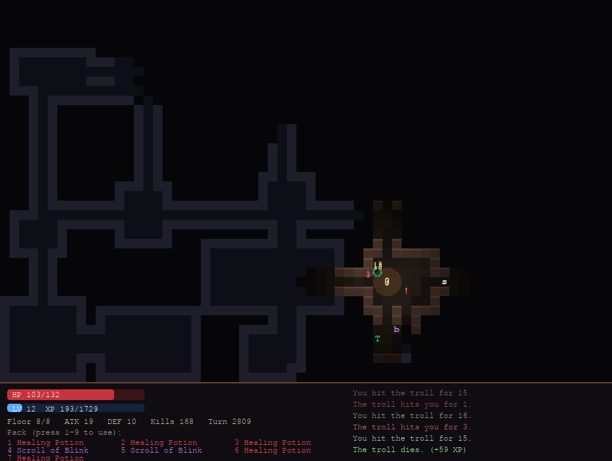

# Ember Crypt (Python + pygame)

A roguelike dungeon crawler. Go down 8 randomly generated floors by torchlight, level up, and destroy the **Lich** waiting at the bottom. Every run is a new dungeon.



## Run it
```bash
pip install pygame
python ember_crypt.py          # random dungeon
python ember_crypt.py 42       # replay a specific dungeon seed
python test_ember_crypt.py     # test suite (about 3 minutes)
```

## Controls
| Key | Action |
|---|---|
| Arrows / WASD | Move (walk into a monster to attack) |
| Q E Z C or numpad | Move diagonally |
| Space or `.` | Wait a turn |
| Enter or `>` | Go down the stairs |
| 1–9 | Use an item from your pack |
| R | New run after death or victory |

## The dungeon
| Monster | Notes |
|---|---|
| `r` rat, `b` bat | Floor 1+. Bats flutter around unpredictably |
| `g` goblin | Floor 2+ |
| `s` skeleton | Floor 3+ |
| `o` orc | Floor 4+ |
| `W` wraith | Floor 5+. Hits hard |
| `T` troll | Floor 6+. **Regenerates** health every turn |
| `L` the Lich | Floor 8 boss. Throws shadow bolts from a distance |

Items: `!` Healing Potion, `?` Scrolls of **Fireball** (area damage), **Lightning** (big single hit), and **Blink** (teleport), plus `)` sharper blades and `[` sturdier armor that upgrade you on pickup. Killing monsters gives XP, and each level up raises your max HP, attack, and defense.

## How it works
| System | Technique |
|---|---|
| **Dungeon generation** | **Binary space partitioning**: the map is split into boxes again and again, a room goes in each leaf, and sibling boxes are joined bottom-up with corridors, so every room is guaranteed to be reachable. A few extra corridors add loops so you can escape fights. |
| **Field of view** | **Recursive shadowcasting**: the view is scanned in 8 triangular octants, and when a wall blocks a range of angles, everything behind it stays dark. Explored areas are remembered and drawn dimmed. |
| **Monster AI** | **A\* pathfinding** with a Chebyshev-distance heuristic around walls and other monsters. Monsters that spot you stay alert and hunt you. |
| **Lich bolts** | **Bresenham line of sight**, so it can only shoot when nothing is in the way |
| **Lighting** | Brightness fades with distance from your torch, with a slight flicker |
| **Design** | Game logic (`World`) has no graphics code at all, which is what makes the bot tests below possible |

## Testing
`test_ember_crypt.py`:
- **300 random floors:** every floor tile is reachable, nothing spawns in a wall or on top of something else, the stairs are reachable, and the last floor has the Lich and no stairs.
- **Field of view:** open rooms are fully lit, solid walls block sight, and doorways only show what's straight through.
- **A\*:** 750 random paths, each checked to be exactly as short as a breadth-first search says is possible.
- **100 full games played by a bot** (about 237,000 turns), with the rules checked after every turn: no crashes, nothing inside walls, no two monsters on one tile. The bot beats the Lich in about 22% of runs, which is how the monster stats were balanced: winnable, but not easy.
- **Rendering:** real frames are drawn headless and keyboard input is simulated.
