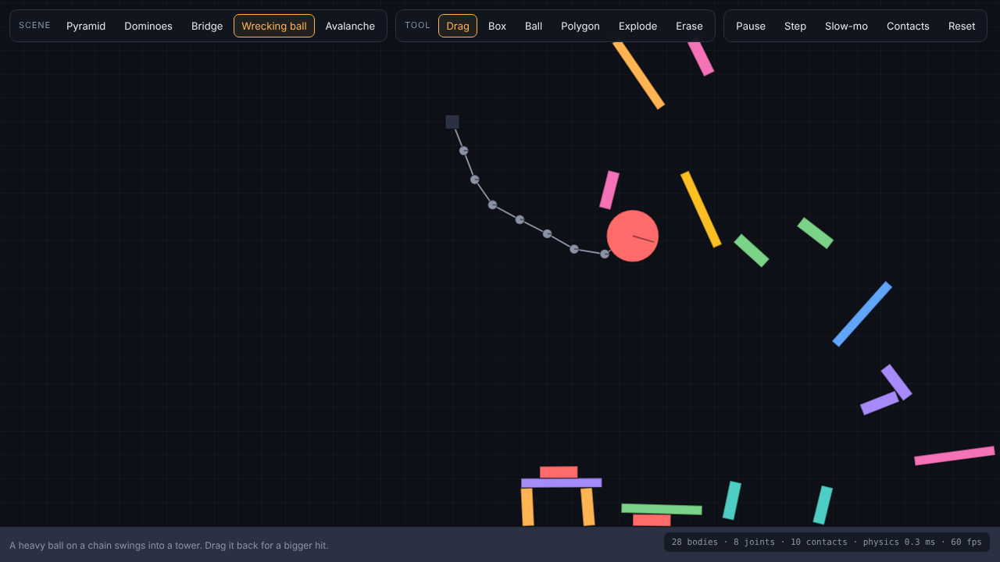

# Physics Sandbox: a 2D rigid-body physics engine from scratch

A 2D physics engine written in plain JavaScript with no libraries, plus a sandbox page to play with it. Boxes stack, balls bounce, bridges sag, and wrecking balls knock towers over. The engine is tested against the formulas from a physics textbook.



## Run it
Open `index.html` in a browser (keep `physics.js` next to it).

| Scene | What happens |
|---|---|
| Pyramid | 91 boxes stacked 13 rows high |
| Dominoes | A ball rolls down a ramp and starts a domino chain |
| Bridge | A rope bridge of 22 planks held by joints |
| Wrecking ball | A heavy ball on a chain swings into a tower |
| Avalanche | Shapes pour down two ramps into a bin |

| Tool (key) | What it does |
|---|---|
| Drag (1) | Grab any body and throw it. It is pulled by a spring toward the mouse |
| Box / Ball / Polygon (2–4) | Click to spawn a shape |
| Explode (5) | Blast everything near the click |
| Erase (6) | Delete a body |

Space pauses, **Step** advances one frame, **Slow-mo** runs at quarter speed, **Contacts** shows contact points and impulses, and R resets the scene.

## How it works
Each frame (1/60 s) is split into 6 sub-steps. Each sub-step does the following:

1. **Broad phase.** Bodies are sorted by their left edge and swept. Only pairs whose bounding boxes overlap get tested.
2. **Narrow phase.** The Separating Axis Theorem finds the axis of least overlap between two convex polygons. The reference face is clipped against the incident face to get up to 2 contact points. Contacts start 2 cm *before* bodies touch ("speculative contacts"), so fast objects don't tunnel through each other.
3. **Warm starting.** Contacts are matched to the previous frame's by position, and they reuse last frame's impulses as a starting guess. This is what lets tall stacks settle.
4. **Velocity solver** (sequential impulses):
   - Friction is clamped to the Coulomb cone `|Pt| ≤ μ·Pn`.
   - For two-point contacts, a 2×2 **block solver** solves both points at once, so boxes don't rock.
   - Restitution only applies above 1 m/s, so resting objects don't jitter.
5. **Integrate** the positions.
6. **Position solver.** Leftover overlap is pushed apart directly (non-linear Gauss–Seidel), without adding energy the way a velocity "bias" would.

Distance joints hold rods and ropes (a rope is a joint that only pulls). Friction combines as `√(μa·μb)`, and restitution takes the larger of the two values.

## Testing
```bash
node test_physics.js      # the engine, against physics formulas
python test_browser.py    # the page in a real browser (needs: pip install playwright && python -m playwright install chromium)
```

**Engine: 16 tests, each compared with the formula it should obey**

| Test | Result | Formula |
|---|---|---|
| Free fall for 2 s | 80.37 m | ½gt² = 80.40 m |
| Elastic collision | velocities swap; momentum and energy kept | |
| Bounce from 5 m at e = 0 / 0.5 / 0.9 | 0.00 / 1.26 / 4.07 m | e²h = 0 / 1.25 / 4.05 m |
| Sliding box at 6 m/s | stops after 3.67 m | v²/2μg = 3.67 m |
| 35° slope, μ = 0.5 | a = 1.61 m/s² | g(sin θ − μ cos θ) = 1.61 |
| 4 m pendulum | period 4.017 s | 2π√(L/g) = 4.014 s |
| Stacks: column of 10, pyramid of 120, wall of 60 bricks | stand for 10 s with under 1 mm drift | |
| 3,000 random polygon pairs | contacts found exactly when shapes overlap | brute-force geometry check |
| Determinism | two runs are bit-for-bit identical | |

**Browser: 14 tests.** These check that every scene runs without NaNs or runaway speeds, the pyramid stays standing, the bridge holds, and the tools work (spawning, dragging, explode, pause, single step). They also check that the 91-box pyramid steps in about 3 ms, well inside a 16 ms frame, with no JavaScript errors.
