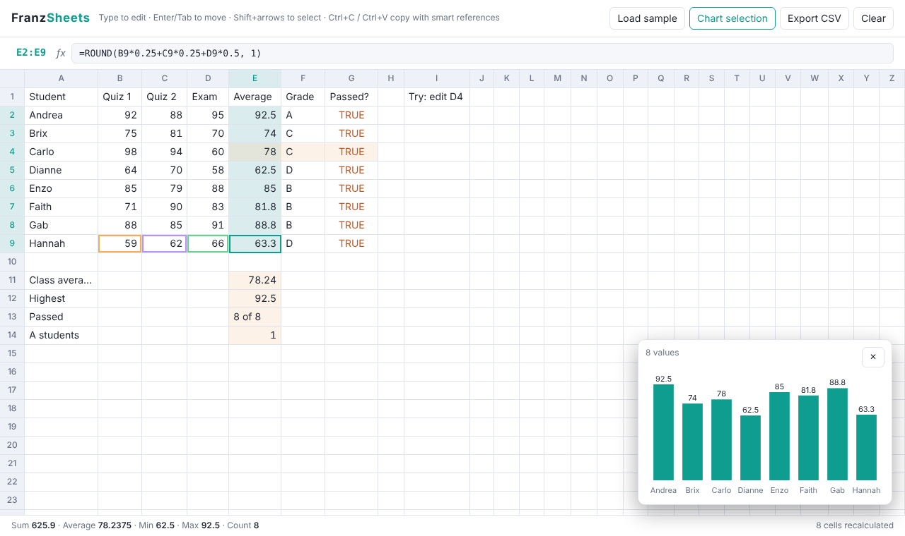

# FranzSheets: a spreadsheet with its own formula engine

A spreadsheet that runs in the browser, built from scratch with no libraries. It has a formula parser that follows Excel's rules, a dependency graph that recalculates only what changed, cycle detection, and copy/paste that adjusts references.



## Run it
Open `index.html` in a browser (keep `engine.js` next to it). Click **Load sample** for a grade sheet, then change an exam score and watch the averages, letter grades, and chart update.

| Action | How |
|---|---|
| Edit | Type, or press Enter / F2 / double-click |
| Move | Arrows, Enter, Tab |
| Select a range | Shift+arrows or drag; the status bar shows Sum / Average / Min / Max |
| Copy / paste | Ctrl+C / Ctrl+V; references shift like Excel (`$A$1` stays fixed) |
| Chart | Select numbers, then **Chart selection** |

Your sheet is saved in the browser automatically. **Export CSV** downloads it.

## Formulas
```
=ROUND(B2*0.25 + C2*0.25 + D2*0.5, 1)
=IF(E2>=90, "A", IF(E2>=80, "B", "C"))
=COUNTIF(E2:E9, ">=60") & " of " & COUNT(E2:E9)
```
- **Operators:** `+ - * / ^ %`, `&` (join text), `= <> < > <= >=`
- **Functions:** `SUM AVERAGE MIN MAX COUNT COUNTA COUNTIF SUMIF IF IFERROR AND OR NOT ROUND ABS SQRT MOD POWER PI LEN UPPER LOWER CONCAT`
- **Errors:** `#DIV/0!`, `#VALUE!`, `#NAME?`, `#REF!`, `#NUM!`, `#ERROR!` (bad formula), and `#CYCLE!` (circular reference)

## How it works
**1. Parsing with Excel's precedence.** A Pratt parser handles operator precedence, including Excel's quirks:
- `-2^2 = 4`, because unary minus binds tighter than `^`
- `2^3^2 = 64`, because `^` groups left to right

**2. The dependency graph.** Each cell records which cells it reads, and a reverse map records which cells read it. When you edit a cell:
1. Walk the reverse map to find every cell that depends on it, directly or indirectly.
2. Run **Tarjan's strongly-connected-components algorithm** on just those cells. It outputs groups in exactly the right order to evaluate them, with dependencies first.
3. Any group that loops (`A1 → B1 → A1`) is a cycle and becomes `#CYCLE!`. Cells that only *read* a cycle are evaluated normally, so `=IF(TRUE, 5, A1)` still gives 5.

Only the affected cells are recalculated; the status bar shows how many.

**3. Copy/paste.** Pasting `=A1+$B$1` one row down gives `=A2+$B$1`. References pushed off the sheet become `#REF!`, like Excel.

## Testing
```bash
node test_engine.js       # engine: about 10 seconds
python test_browser.py    # real browser (needs: pip install playwright && python -m playwright install chromium)
```
| Test | What it proves |
|---|---|
| 44 known answers | Excel's results for precedence, text/number conversion, booleans, errors, and functions |
| **Parser fuzzing** | 20,000 random formulas are printed with the *fewest* parentheses Excel allows, parsed back, and must evaluate exactly like the original tree |
| **Recalculation fuzzing** | 4,800 random edits (sums, IFs, chains, and cycles that appear and disappear). After every edit, each cell must equal a from-scratch recursive evaluation, and only cells that depend on the edit may be recalculated |
| Copy/paste | `$` anchors, ranges, text inside quotes, and `#REF!` off the sheet |
| Browser | Typing, recalculation, copy/paste, cycles, selection stats, the sample sheet, the chart, saving across reloads, and no JavaScript errors |
